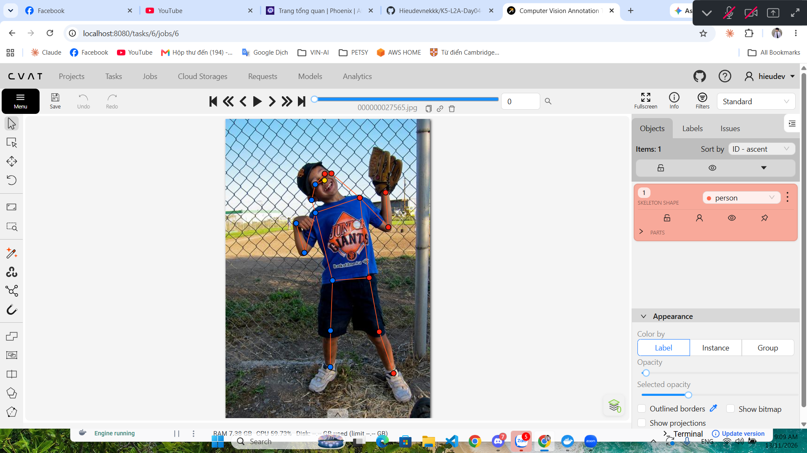
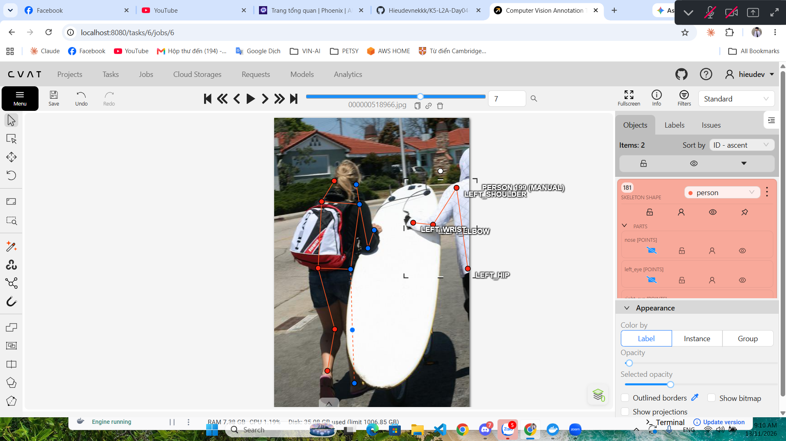
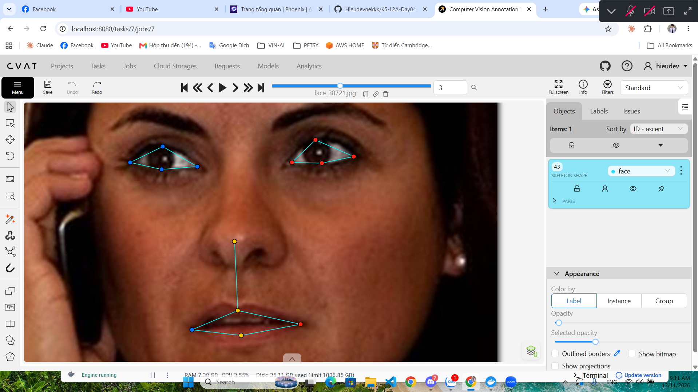
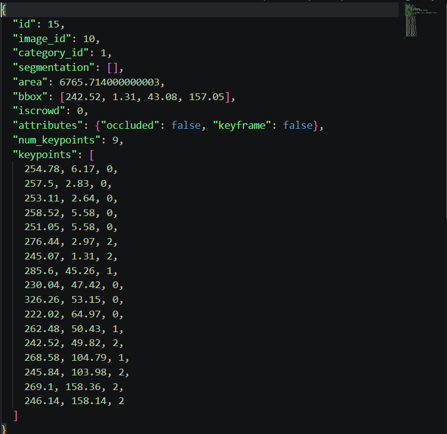

# Báo cáo cá nhân — Nguyễn Minh Hiếu - 2A202603091

Dữ liệu: 12 ảnh người COCO val2017 (Lin et al., 2014) và 8 ảnh chân dung Wikimedia Commons, chỉ dùng trong lớp.

## 0. Thông tin học viên

- Họ tên: Nguyễn Minh Hiếu
- MSSV: 2A202603091
- Email: 26ai.hieunm11@vinuni.edu.vn
- Link repository: https://github.com/Hieudevnekkk/K5-L2A-Day04-NguyenMinhHieu-03091-KeypointPose
- Phiên bản CVAT (Help → About): CVAT 2.82.1
- Máy: hệ điều hành Win · RAM 16 GB · chạy CVAT chế độ đầy đủ / lite
- Bộ ảnh (`src/exports/assignment.json` do `lab.py setup` tạo): có / không
- Giờ bắt đầu: 16h
- Giờ kết thúc: 19h

## 1. Kiểm tra label (CP0)

| Label    | Kiểu     | Số điểm | Tên điểm đúng bảng của lab? | Đúng thứ tự? | Số cạnh |
| -------- | -------- | ------: | --------------------------- | ------------ | ------: |
| `person` | Skeleton |      17 | Có                          | Có           |      19 |
| `face`   | Skeleton |      13 | Có                          | Có           |      13 |

Mẫu `person` dựng theo người quay mặt về camera (các điểm `left_*` nằm bên phải khung mẫu)? Có

Cách đổi cờ `occluded` / `outside` cho **một điểm** trên phiên bản CVAT này (một câu):

Rê chuột vào đúng điểm cần đổi (điểm sáng lên) rồi bấm `Q` để bật/tắt `occluded` hoặc `O` để bật/tắt `outside` (hoặc chuột phải vào điểm và chọn nút tương ứng trong menu); chỉ điểm đó bị đổi, các điểm khác của skeleton giữ nguyên.

## 2. Số lượng đã gán và thời gian (CP1, CP2)

| Nhóm ảnh   | Số ảnh | Số skeleton đã gán | Số người dưới 60 px (không gán) | Số poster / gương / màn hình bỏ qua | Thời gian (phút) |
| ---------- | -----: | -----------------: | ------------------------------: | ----------------------------------: | ---------------: |
| `easy`     |      5 |                  5 |                                 |                                     |                  |
| `occluded` |      3 |                  6 |                                 |                                     |                  |
| `back`     |      2 |                  4 |                                 |                                     |                  |
| `small`    |      1 |                  4 |                                 |                                     |                  |
| `crowd`    |      1 |                  3 |                                 |                                     |                  |
| `faces`    |      8 |                  8 |                               — |                                     |                  |

- Số ảnh người đã xong ở mốc phút 105: 10 / 10
- Thời gian thực tế (phút): CP1 **_ · CP2 _** · CP3 \_\_\_
- Ảnh tốn thời gian nhất là ảnh nào, vì sao?

`000000572411.jpg` (nhóm `small`): có 4 người nhỏ, các điểm chỉ trải cao 31–69 px nên phải phóng to
tối đa mới đặt được điểm. Khớp tay và chân rất khó phân biệt nên phải đặt cờ nhiều:
tổng cộng 10 điểm `occluded` và 20 điểm `outside`. Ngoài ra phải cân nhắc người nào đủ 60 px để gán,
và kiểm lại trái/phải ở cổ tay (script báo 2 cảnh báo đổi cặp `wrist` ở người #1 và #3).

## 3. Bảng ca khó (CP1, CP2)

Mỗi điểm bạn phân vân một dòng, nhất là phân vân giữa `v = 1` và `v = 0`, hoặc không chắc hướng người.

| Ảnh                             | Người / mặt           | Điểm                                                      | Cờ đã chọn | Phân vân giữa                | Lý do chọn                                                                                                                                 |
| ------------------------------- | --------------------- | --------------------------------------------------------- | ---------: | ---------------------------- | ------------------------------------------------------------------------------------------------------------------------------------------ |
| `000000518966.jpg` (`back`)     | người #2 (phía sau)   | mặt (`nose`, 2 mắt, 2 tai) + toàn bộ nửa phải và hai chân |          0 | `v = 1` / `v = 0`            | Người quay lưng và bị che gần hết, chỉ thấy 4 điểm bên trái. Không ước lượng chắc vị trí các khớp còn lại nên để `outside`, không đoán bừa |
| `000000518966.jpg` (`back`)     | người #1              | `nose`, `left_eye`                                        |          0 | `v = 1` / `v = 0`            | Người quay lưng, không thấy mũi và mắt, không đoán chắc → `outside`; tai thấy viền nên vẫn để `v = 2`                                      |
| `000000431988.jpg` (`back`)     | người #1              | `left_wrist`                                              |          0 | `v = 1` / `v = 0`            | Cổ tay bị thân che, không thấy cẳng tay để suy ra hướng nên chọn `outside`; khuỷu phải vẫn đoán chắc theo vai nên để `v = 1`               |
| `000000175703.jpg` (`easy`)     | người #1              | `nose`, 2 mắt, 2 tai                                      |          0 | `v = 1` / `v = 0`            | Đầu bị che / ra ngoài vùng nhìn được, không có mốc để ước lượng mặt → `outside`                                                            |
| `000000521817.jpg` (`occluded`) | người #1              | `left_knee`, `right_knee` / `left_ankle`, `right_ankle`   |      1 / 0 | `v = 1` / `v = 0`            | Gối bị vật che nhưng ước lượng chắc theo đùi và hông → `occluded`; cổ chân không còn mốc nào → `outside`                                   |
| `000000522889.jpg` (`crowd`)    | người #1 (đứng sau)   | `left_elbow`, `left_hip`, `left_knee`                     |          1 | `v = 1` / `v = 0`            | Bị người phía trước che, nhưng lần theo chi từ vai / hông vẫn ước lượng được → `occluded`; mặt và hai cổ tay không thấy → `outside`        |
| `000000522889.jpg` (`crowd`)    | người #3              | cổ tay, gối, cổ chân                                      |          2 | đúng trái/phải hay `lr_swap` | Script báo cặp `wrist`, `knee`, `ankle` ngược phía. Kiểm lại thì tay chân bắt chéo thật, giữ nguyên trái/phải theo người trong ảnh         |
| `000000572411.jpg` (`small`)    | người #4 (cao ~35 px) | `left_wrist`, `right_wrist`, gối, cổ chân                 |          0 | `v = 1` / `v = 0`            | Người nhỏ, chi dưới lẫn vào nền, phóng to vẫn không thấy khớp → `outside`; hông ước lượng được theo thân → `v = 1`                         |
| `face_13874.jpg` (`kinh_ram`)   | mặt #1                | 8 điểm mắt (`*_eye_outer/inner/upper/lower`)              |          1 | `v = 1` / `v = 0`            | Kính râm che mắt nhưng vị trí mắt ước lượng chắc theo gọng kính → `occluded`, không để `outside`                                           |
| `face_556064.jpg` (`kinh`)      | mặt #1                | `right_eye_upper`                                         |          1 | `v = 2` / `v = 1`            | Mí trên mắt phải bị gọng kính che, các điểm mắt khác vẫn thấy rõ qua tròng → chỉ điểm này `occluded`                                       |

## 4. Bảng tự review (CP3)

Đi từ ảnh cuối về ảnh đầu. 5 ảnh người (ít nhất 2 ảnh `back` hoặc `crowd`) và 3 ảnh mặt. Ít nhất 8 dòng, kể cả dòng `ok`. Ghi lỗi trước, sửa sau.

Mã lỗi dùng đúng một trong: `lr_swap`, `vis_flag`, `position`, `missing`, `extra`, `ok`.

| Ảnh                             | Người / mặt  | Điểm                           | Mã lỗi    | Ghi chú                                                                                                                           | Đã sửa? |
| ------------------------------- | ------------ | ------------------------------ | --------- | --------------------------------------------------------------------------------------------------------------------------------- | ------- |
| `000000522889.jpg` (`crowd`)    | người #3     | `*_wrist`, `*_knee`, `*_ankle` | `lr_swap` | Script báo 3 cặp nằm ngược phía so với vai / hông. Kiểm lại hướng người: trái/phải phải theo người trong ảnh, không theo màn hình |         |
| `000000522889.jpg` (`crowd`)    | người #1, #2 | toàn bộ                        | `ok`      | Mỗi người một skeleton riêng, không có xương vắt sang người khác; cờ `occluded` / `outside` hợp lý                                | —       |
| `000000572411.jpg` (`small`)    | người #1     | toàn bộ skeleton               | `extra`   | Các điểm chỉ trải cao 31 px (< 60 px). Nếu người thật sự dưới 60 px thì xóa skeleton                                              |         |
| `000000572411.jpg` (`small`)    | người #4     | toàn bộ skeleton               | `extra`   | Các điểm chỉ trải cao 35 px (< 60 px), cùng xử lý như người #1                                                                    |         |
| `000000572411.jpg` (`small`)    | người #1, #3 | `left_wrist`, `right_wrist`    | `lr_swap` | Script báo cặp `wrist` ngược phía; người nhỏ nên dễ đặt nhầm tay                                                                  |         |
| `000000518966.jpg` (`back`)     | người #1, #2 | toàn bộ                        | `ok`      | Người quay lưng: `left_*` nằm bên trái người trong ảnh (phía trái màn hình); mặt không thấy để `outside`                          | —       |
| `000000431988.jpg` (`back`)     | người #1, #2 | toàn bộ                        | `ok`      | Hai người quay lưng, trái/phải đúng, tai thấy viền giữ `v = 2`                                                                    | —       |
| `000000521817.jpg` (`occluded`) | người #1     | `left_eye`, `right_eye`        | `lr_swap` | Script báo cặp `eye` ngược phía so với các cặp còn lại                                                                            |         |
| `face_38721.jpg` (`toc`)        | mặt #1       | 13 điểm                        | `ok`      | Tóc không che mắt nên để `v = 2` cả 13 điểm                                                                                       | —       |
| `face_13874.jpg` (`kinh_ram`)   | mặt #1       | 8 điểm mắt                     | `ok`      | Kính râm che mắt: 8 điểm mắt `occluded` (`v = 1`), mũi và miệng `v = 2`                                                           | —       |
| `face_556064.jpg` (`kinh`)      | mặt #1       | 13 điểm                        | `ok`      | Chỉ `right_eye_upper` bị gọng che (`v = 1`), các điểm khác thấy rõ qua tròng kính                                                 | —       |

Tổng hợp số lỗi theo mã:

| `lr_swap` | `vis_flag` | `position` | `missing` | `extra` | `ok` |
| --------: | ---------: | ---------: | --------: | ------: | ---: |
|         3 |          0 |          0 |         0 |       2 |    6 |

Điểm còn phân vân giữa `v = 1` và `v = 0` (ghi cả hai lựa chọn và lý do chọn):

- `000000431988.jpg` người #1, `left_wrist`: chọn `v = 0` (`outside`), không chọn `v = 1` (`occluded`). Cổ tay bị thân che hoàn toàn và không thấy cẳng tay, nên không ước lượng chắc vị trí. Theo quy tắc "không đoán bừa", điểm này để `outside`.
- `000000522889.jpg` người #1, `left_elbow`: chọn `v = 1` (`occluded`), không chọn `v = 0` (`outside`). Khuỷu bị người phía trước che, nhưng vai trái và hông trái đều thấy, nên lần theo chi từ vai vẫn ước lượng được vị trí.

## 5. Kiểm file xuất và kết quả tự kiểm (CP4)

Tự kiểm tay trong file JSON:

| File                         | Người / mặt kiểm (ảnh, thứ tự)                           | Số phần tử `keypoints` | Điểm `outside` ra `v = 0`, `occluded` ra `v = 1`?             | `num_keypoints` khớp?                      |
| ---------------------------- | -------------------------------------------------------- | ---------------------: | ------------------------------------------------------------- | ------------------------------------------ |
| `NguyenMinhHieu_persons.zip` | `000000518966.jpg`, người #2 (quay lưng, bị che gần hết) |                     51 | Có: 13 điểm `outside` ra `v = 0`, không có `occluded`         | Có: `num_keypoints = 4` = 4 điểm `v > 0`   |
| `NguyenMinhHieu_persons.zip` | `000000522889.jpg`, người #1 (`crowd`, đứng sau)         |                     51 | Có: 8 điểm `outside` ra `v = 0`, 3 điểm `occluded` ra `v = 1` | Có: `num_keypoints = 9` = 9 điểm `v > 0`   |
| `NguyenMinhHieu_faces.zip`   | `face_13874.jpg`, mặt #1 (kính râm)                      |                     39 | Có: 8 điểm mắt `occluded` ra `v = 1`, không có `outside`      | Có: `num_keypoints = 13` = 13 điểm `v > 0` |

Sau khi xuất, CVAT ghi `occluded` thành `v = 1` và `outside` thành `v = 0`. Tọa độ của điểm `outside` trong file là `0, 0` hay tọa độ cũ? Tọa độ cũ (ví dụ `000000518966.jpg` người #2, `nose` = `426.38, 105.63`, `v = 0`).

Hai job đã chuyển sang completed trên CVAT? Có / Không

Dán phần **TÓM TẮT** in ra từ `src/check_submission.py`:

```text
----- TÓM TẮT (dán vào báo cáo mục 5) -----
- File person: NguyenMinhHieu_persons.zip
  Số ảnh: 12 · số skeleton `person`: 22 · mỗi annotation 51 số
  Skeleton theo ảnh: 000000027565=1, 000000109010=2, 000000175703=1, 000000311497=2, 000000431988=2, 000000433787=1, 000000451084=1, 000000518966=2, 000000521817=2, 000000522889=3, 000000564304=1, 000000572411=4
  Cờ v: v=2 273 (73%) · v=1 36 (10%) · v=0 65 (17%)
  num_keypoints trung bình: 14.0
- File face: NguyenMinhHieu_faces.zip
  Số ảnh: 8 · số skeleton `face`: 8 · mỗi annotation 39 số
  Skeleton theo ảnh: face_13874=1, face_145621=1, face_300399=1, face_38721=1, face_425647=1, face_442231=1, face_496353=1, face_556064=1
  Cờ v: v=2 95 (91%) · v=1 9 (9%) · v=0 0 (0%)
  num_keypoints trung bình: 13.0
- Ghi chú: 65 điểm v = 0 vẫn mang tọa độ cũ (CVAT 2.x xuất như vậy; chuẩn COCO ghi 0, 0). Không phải lỗi: điểm v = 0 bị bỏ qua khi huấn luyện và khi chấm.
- Số [LỖI]: 0 · số [CẢNH BÁO]: 7
Kết quả: ĐẠT (đọc lại từng cảnh báo ở trên)
```

Các `[CẢNH BÁO]` còn giữ nguyên và lý do:

- `000000311497.jpg` #2 — cặp `knee`, `ankle` ngược phía: chân bắt chéo thật trong ảnh, trái/phải gán theo người.
- `000000521817.jpg` #1 — cặp `eye` ngược phía: đầu quay nghiêng so với thân nên thứ tự mắt khác thứ tự vai / hông.
- `000000522889.jpg` #3 — cặp `wrist`, `knee`, `ankle` ngược phía: tay và chân bắt chéo thật, đã kiểm hướng người.
- `000000572411.jpg` #1, #3 — cặp `wrist` ngược phía: hai tay bắt chéo trước người, đã phóng to kiểm lại.
- `000000572411.jpg` #1 (31 px), #4 (35 px) — dưới 60 px: người cao hơn 60 px nhưng bị che / cắt phần chân, các điểm thấy được chỉ trải 31–35 px nên vẫn gán.

## 6. Ảnh chụp màn hình

1. Label `person` trong label constructor (đủ 17 điểm có tên):

   

2. Một người quay lưng đã gán, cờ đã đặt:

   

3. Một khuôn mặt đã gán 13 điểm, phóng to vùng mắt:

   

4. Một đoạn JSON xuất của một người:

   

Nguồn ảnh: COCO val2017 / Wikimedia Commons.

## 7. Tự đánh giá

1. Lỗi bạn mắc nhiều nhất hôm nay, và cách bạn sẽ tránh ở dự án thật:

   Lỗi nhiều nhất là `lr_swap`: script báo 5 người có cặp trái/phải nằm ngược phía (`000000311497` #2, `000000521817` #1, `000000522889` #3, `000000572411` #1 và #3), chủ yếu ở cổ tay, gối, cổ chân của người nhỏ hoặc người trong đám đông. Ở dự án thật tôi sẽ: (1) xác định hướng người trước khi đặt điểm đầu tiên (nhìn mặt, ngực, mũi chân); (2) luôn đặt vai và hông trước, rồi lần theo chi vai → khuỷu → cổ tay, hông → gối → cổ chân; (3) bật màu khác nhau cho điểm trái/phải trong CVAT và chạy script tự kiểm sau mỗi 3–4 ảnh thay vì đợi cuối buổi.

2. Một quy tắc bạn đề xuất thêm vào guideline (kèm ảnh ví dụ nếu có):

   Với người bị cắt khung hoặc bị che mà các điểm thấy được chỉ trải dưới 60 px (ví dụ `000000572411.jpg` người #1, #4), guideline nên nói rõ: đo chiều cao **ước lượng của cả người** (đầu đến chân, kể cả phần bị che) chứ không đo khoảng trải của các điểm đã gán. Nếu ước lượng ≥ 60 px thì gán và ghi vào bảng ca khó; nếu không ước lượng được thì không gán. Hiện script chỉ đo khoảng trải điểm nên dễ gây phân vân.

3. Nhãn của bạn đi vào model ở đâu? Chọn một lỗi bạn đã sửa và nói nó sẽ làm model học sai thế nào (heatmap, trọng số trong loss, hay bước lật ảnh):

   Chọn lỗi `lr_swap` ở cổ tay (`000000572411.jpg` người #3). Lỗi này hỏng ở **bước lật ảnh**: khi ảnh lật ngang, code tính `x' = W − x` rồi đổi tên `left_wrist` ↔ `right_wrist`. Nếu nhãn gốc đã ngược thì sau khi lật nó thành đúng, còn ảnh gốc vẫn sai, nên model nhận hai tín hiệu mâu thuẫn cho cùng một tư thế. Nó cũng làm sai **heatmap đích**: đồi Gauss của `left_wrist` nằm ở cổ tay phải, đồi bè ra giữa hai tay, đỉnh thấp, model học cách "đoán giữa" và hay nhầm tay ở người nhỏ. Vì điểm có `v = 2`/`v = 1` nên trọng số trong loss là 1, lỗi được học đầy đủ chứ không bị bỏ qua.

## 8. Khó khăn và lỗi kỹ thuật

- Ảnh `small` và người phía sau trong `crowd` rất nhỏ, phải phóng to tối đa và rê chuột chính xác vào từng điểm mới đổi được cờ bằng `Q` / `O`; nhiều lần rê lệch nên đổi nhầm cờ điểm bên cạnh.
- Cờ `hidden` (`H`) dễ nhầm với `outside`: `hidden` chỉ ẩn trên màn hình, không được lưu, khi xuất vẫn ra `v = 2`. Phải kiểm lại bằng cách mở JSON xuất.
- CVAT 2.x xuất điểm `outside` với tọa độ cũ thay vì `0, 0` như chuẩn COCO, ban đầu tưởng là lỗi export.
- Trên Windows, chạy `src/check_submission.py` bị lỗi `UnicodeEncodeError` khi in tiếng Việt; phải đặt `PYTHONIOENCODING=utf-8` trước khi chạy.

## Bonus (nếu làm)

### B1 — 3 ảnh người khó thêm

| Ảnh                | Số skeleton | Số người dưới 60 px | Ca khó nhất                                                                                                                                                                                               |
| ------------------ | ----------: | ------------------: | --------------------------------------------------------------------------------------------------------------------------------------------------------------------------------------------------------- |
| `000000125998.jpg` |           3 |                   0 | Cả 3 người bị cắt phần trên khung: đầu, vai không có trong ảnh (`outside`), chỉ còn hông và chân. Người #1 chỉ còn 5 điểm thấy; hông của người #2, #3 bị che nhưng ước lượng được theo đùi nên để `v = 1` |
| `000000213506.jpg` |           2 |                   0 | Người #2 thấy rõ mũi và hai mắt nhưng các điểm `left_*` nằm bên trái ảnh. Script báo có thể `lr_swap` cả người, cần kiểm lại người quay mặt hay quay lưng                                                 |
| `000000337458.jpg` |           3 |                   0 | Người #1 nhỏ (~68 px), mặt nghiêng: `nose`, `left_eye`, `right_ear` bị che nhưng đoán được (`v = 1`), `right_eye` khuất hẳn (`v = 0`). Người #3 quay lưng, không thấy mặt và hai tay                      |

Kết quả `src/check_submission.py` cho `NguyenMinhHieu_bonus_persons.zip`:

```text
=== src\exports\NguyenMinhHieu_bonus_persons.zip (label `person`) ===
  [CẢNH BÁO] 000000213506.jpg #2: thấy rõ mũi và hai mắt (v = 2) nhưng các điểm left nằm bên TRÁI ảnh, tức là gán như người quay lưng. Kiểm lại hướng người (`lr_swap` cả người?).

----- TÓM TẮT (dán vào báo cáo mục 5) -----
- File person: NguyenMinhHieu_bonus_persons.zip
  Số ảnh: 3 · số skeleton `person`: 8 · mỗi annotation 51 số
  Skeleton theo ảnh: 000000125998=3, 000000213506=2, 000000337458=3
  Cờ v: v=2 72 (53%) · v=1 13 (10%) · v=0 51 (38%)
  num_keypoints trung bình: 10.6
- File face: NguyenMinhHieu_bonus_faces.zip
  Số ảnh: 5 · số skeleton `face`: 5 · mỗi annotation 39 số
  Skeleton theo ảnh: face_280788=1, face_296417=1, face_317330=1, face_494518=1, face_507166=1
  Cờ v: v=2 63 (97%) · v=1 2 (3%) · v=0 0 (0%)
  num_keypoints trung bình: 13.0
- Ghi chú: 51 điểm v = 0 vẫn mang tọa độ cũ (CVAT 2.x xuất như vậy; chuẩn COCO ghi 0, 0). Không phải lỗi: điểm v = 0 bị bỏ qua khi huấn luyện và khi chấm.
- Số [LỖI]: 0 · số [CẢNH BÁO]: 1
Kết quả: ĐẠT (đọc lại từng cảnh báo ở trên)
```

### B2 — 5 ảnh khuôn mặt đen trắng / hồng ngoại

Ảnh không màu khó hơn ở điểm nào? Kính râm trên ảnh hồng ngoại có còn là `v = 1` không?

Cả 5 ảnh được giao đều là ảnh đen trắng (`den_trang`), đã gán đủ 13 điểm mỗi mặt: 63 điểm `v = 2`, 2 điểm `v = 1` (`face_317330.jpg`: `mouth_right`, `lip_upper`), không có `v = 0`.

Ảnh không màu khó hơn vì mất tương phản màu: ranh giới môi và da (`lip_upper`, `lip_lower`, khóe miệng) gần như cùng độ xám, phải dựa vào bóng đổ và nếp để đặt điểm; tròng mắt và mí cũng khó tách khi vùng mắt tối, nên `*_eye_upper` / `*_eye_lower` dễ lệch vài pixel.

Kính râm trên ảnh hồng ngoại: không phải lúc nào cũng là `v = 1`. Nhiều loại kính râm cho tia hồng ngoại đi qua, nên trên ảnh IR có thể thấy rõ mắt sau tròng → khi đó là `v = 2`. Chỉ khi tròng vẫn tối, không thấy mắt nhưng ước lượng chắc vị trí theo gọng thì mới là `v = 1` (như `face_13874.jpg` ở ảnh màu). Bộ ảnh của tôi không có ảnh IR có kính râm nên đây là quy tắc tôi sẽ áp dụng, chưa gặp thực tế.

### B3 — Model so với nhãn của tôi (không tính điểm)

- Demo đã dùng:
- Ảnh đã thử:

1. Model có trả điểm cho khớp bị che, hay khớp ngoài ảnh không? Confidence ở các điểm đó thế nào?

   ...

2. Với người quay lưng, model có đổi trái/phải không?

   ...

3. Bộ điểm của model có giống 17 điểm COCO không?

   ...

## 9. Tài liệu tham khảo và công cụ AI đã dùng

...
